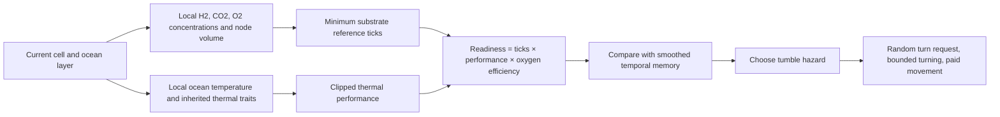

# Geodesic food sensing and steering audit — 17 November 2026

> **Checkpoint evidence boundary:** the later [position-dependent vent temperature](GeodesicPositionDependentVentTemperature.md) changes individual thermal sampling, and [founder emergence](GeodesicFounderEmergence.md) changes initial placement/coverage. The historical native tests and world pairs below were not repeated for those revisions. Use the [roadmap](GEODESIC_MIGRATION_ROADMAP.md) for current acceptance gates.

Later milestone: [Fermentation restoration](GeodesicFermentationParity.md) adds one-resource local OrganicC readiness with individual thermal and O2 scaling. Hydrogen/sulfur signals and movement controls remain unchanged.

Later milestone: [Sulfur restoration](GeodesicSulfurParity.md) extends production sensing to local CO2/H2S, individual temperature and configured O2 efficiency. Hydrogen sensing arithmetic and the hard-zero thermal limitation are unchanged. Earlier hydrogen-only scope statements below describe the audited baseline.

## Findings established before changing response or speed

Hydrogenotroph steering genuinely senses both H2 and CO2 from the organism's
current ocean node. It uses the limiting substrate inventory, multiplied by
individual thermal performance and the existing hydrogenotroph oxygen-efficiency
factor. It is neither temperature-only nor a forecast of actual metabolic energy.

Hard thermal clipping makes different cold habitats indistinguishable through
that combined signal. However, positive temporal memory can continue classifying
every cold observation as worsening for several seconds. That is a loss of
directional information, not necessarily an immediate return to neutral tumbling.

The existing native locomotion and carbon-integration fixtures now execute:
**20 native tests passed** through the already open Editor. A second Editor had
been conflicting with the open project's lock. The sandbox process list hid the
open Editor; outside-sandbox inspection found it and the held lock. Earlier
licensing/bootstrap messages did not establish licensing as the root cause.

Native food-gradient and candidate stages also passed, followed by the completed
seed-283 OFF/ON full-world pair. Steering did not increase amoeboid-parent births
in that pair (one in each trial); no flagella appeared. No speed or response
retuning has been applied to normal gameplay.

The complete measurements, startup configurations and execution counts are in
[FoodTaxisMeasurements.json](Diagnostics/FoodTaxisMeasurements.json). The 48 cohort
outcomes are also in [FoodTaxisEcologicalComparison.csv](Diagnostics/FoodTaxisEcologicalComparison.csv).
A result with zero executed tests is explicitly **not** a successful run.
`Tools/AnalyzeFoodTaxis.py --publish` creates these artifacts from the local results.

## Exact current pathway



The implementation is in `GeodesicBiologyRuntime.Locomotion.cs`:
`SampleMovementHabitat`, `ObserveMovementHabitat`, `RunActiveMovement`,
`SenseActiveHabitat`, `PrepareVerticalExploration`, and `AdvanceActiveVertical`.
`ObserveSteeringHabitat` and memory comparison are in the TaxisDiagnostics partial;
`GeodesicTaxisPolicy` holds the comparison and reference probability decision.

For current node physical volume `V`, local concentrations `cCO2,cH2`, and positive
configured full-tick requirements `nCO2,nH2`:

```
CO2Ticks = cCO2 * V / nCO2
H2Ticks  = cH2  * V / nH2
Q = min(CO2Ticks, H2Ticks)
R = Q * P(T, inheritedMin, inheritedMax, inheritedMargin) * oxygenEfficiency
```

Default requirements are .01 CO2 and .02 H2 per .5-second full reference tick.
The corrected activity fraction .8 still scales the **actual entire reaction**:
.008 CO2, .016 H2, .008 stored carbon and 6.4 energy at full reference activity.
The signal's Q is expressed in full reference ticks before that fraction.

For an organism's inherited optimum `[Tmin,Tmax]` and margin `m`, let
`d=max(Tmin−T,T−Tmax,0)`. Performance is 1 inside the optimum, otherwise
`max(1−d/m, dormancyFloor)` while `1−d/m>0`, and zero beyond the shoulder.
Invalid traits/temperatures give zero. The .02 dormancy floor does not restore
metabolism beyond a zero-performance edge. These are individual traits, not
species-wide immutable survival limits.

Oxygen efficiency is the same configured hydrogenotroph inhibition function as
the reaction: a smoothstep fall from 1 at the comfort concentration toward the
configured minimum at the stress concentration. Disabling inhibition gives 1.
With `comfort=max(0,configuredComfort)`, `stress=max(comfort+.0001,configuredStress)`
and `x=clamp01((localO2−comfort)/(stress−comfort))`, it is
`1 + (clamp01(minimumEfficiency)−1) * x² * (3−2x)`; at/below comfort it is 1.

The display score is approximately:

```
score = ln(1+R) / (ln(2) + ln(1+R))
```

Steering compares raw R, **before** display compression:

```
relativeDelta = (Rcurrent − Rmemory) / max(0.0001, Rcurrent, Rmemory)
Rmemory <- Rmemory + 0.35 * (Rcurrent − Rmemory)
```

Improvement requires a positive delta of at least .05; worsening requires a
negative delta of at most −.05. The readiness floor and deadband suppress small
numerical variations. There is no independent stochastic measurement noise;
amoeboid run noise affects motion. The floor is in reference-tick units.

### What this signal does and does not mean

- It responds to H2 when H2 limits the minimum, and CO2 when CO2 limits it.
  Increasing an already nonlimiting substrate need not improve R. That is correct
  limiting-substrate behavior, not failure to read that concentration.
- It uses the same cell/layer resource authority as reactions. Sensing reads its
  float concentration interface; transactions use the canonical double inventory.
  Cache keys include the layer. Temperature comes from the coarse ocean layer,
  not the separate near-outlet source-fluid temperature query.
- It includes node volume. Uniform chemical concentrations in unequal-volume
  nodes can produce different signals. This reflects the model's available pool,
  rather than a concentration-only receptor model. Vertical layer-volume effects
  can therefore compete with concentration gradients.
- R is pre-competition inventory opportunity. It is not uptake rate, predicted
  per-capita energy, carbon-store capacity, reproductive fitness, or an occupancy-
  corrected share. Extra food above one executable tick still increases R even
  when the immediate fixed-rate reaction cannot get faster.
- Only the currently experienced node and previous observations are used. There
  is no neighbour scan, vent lookup, directional spatial derivative or destination
  evaluation before entering another cell/layer.
- Changing `activeMovementMetabolismSuitabilityEnabled` to false uses thermal
  performance alone. A/B mode B continues observing signals but selects neutral
  horizontal tumbling and random vertical persistence instead of feedback.

### Other metabolisms: an existing support gap

The production movement switch currently implements **Hydrogenotrophy only**.
Sulfur chemosynthesis, methanogenesis, methanotrophy and photosynthesis have
geodesic reaction definitions but no corresponding movement-readiness branch.
They receive zero metabolic movement signal. Saprotrophy, fermentation and
predation also lack active geodesic reaction definitions and are not activated
by this work. `metabolismAwareSensing=True` must not be interpreted as support for
every metabolism. The resolved log now states the hydrogenotroph-only scope.

Native characterization fixtures vary relevant food channels and compare
`BuildRequest` support with observed movement signals. They deliberately expose
this gap; passing a characterization assertion of zero is not food-seeking success.
No generic maximum-H2 attraction or missing reaction has been introduced.

## Zero-signal blindness and numerical interpretation

For founder preferences 323.15–353.15 K and margin 20 K, temperatures at or below
303.15 K have zero performance. A local move from 283 K to 298 K can improve raw
temperature without changing P or R. Increasing H2 during that move also leaves
R zero. Immediately re-entering a viable cell can restore a detectable signal,
but the organism cannot anticipate that destination through its current-node
temporal sampler.

Separate these cases:

| Case | Evidence required | Current consequence |
|---|---|---|
| No H2 gradient | Same local H2 opportunity across sampled positions | No hydrogen information exists to follow. |
| H2 gradient thermally gated | H2Ticks changes, CO2 is not limiting, P remains zero | H2 information exists but is erased from R. |
| Temperature clipped | Different raw temperatures both outside the thermal shoulder | Raw recovery direction is erased from P and R. |
| Resolvable signals, weak response | Nonzero relative deltas affect probabilities, but trajectories fail retention/return | A sensing-correctness test alone cannot establish ecological success. |
| Too much travel between decisions | Actual crossings and sense timestamps | Short productive chords may be crossed without a decision in them. |

Historical vent-profile logs provide real temperature evidence: near t=900 s in
the OFF run, strongest outlet bottom temperature was 334.19 K, whereas the sampled
ring-1 bottoms ranged 276.189–306.505 K (mean 287.892 K). Thus many sampled nearby
habitats were below the founder zero-performance edge. Those ring aggregates
are **not paired adjacent-cell H2 measurements** and do not establish an H2
gradient for a particular departed organism. The fixed-step world fixture exports
bounded, paired centre/neighbour and bottom/above-bottom measurements at 300 and
900 s, with actual node volumes and separate H2Ticks/CO2Ticks.

Completed fixed-step measurements give direct examples, using the saved founder
thermal traits (323.15–353.15 K, 20 K margin), and actual node volumes:

| OFF trial, t=900 s, outlet centred on cell 33364 | Layer | T (K) | H2 concentration | H2Ticks | CO2Ticks | P | R |
|---|---:|---:|---:|---:|---:|---:|---:|
| Centre 33364 | 4 | 327.008 | .00940493 | 5441.51 | 1130646.40 | 1 | 5441.51 |
| Adjacent cell 2134 | 4 | 294.345 | .00325268 | 2190.15 | 1312800.58 | 0 | 0 |
| Adjacent cell 8405 | 4 | 294.553 | .00487647 | 2388.07 | 955006.00 | 0 | 0 |

Both cold neighbours contain appreciable, differing H2. H2 is limiting relative
to CO2, yet the resource gradient and their small temperature difference disappear
from readiness. This is cases B and C, rather than absence of food information.
At t=300 s all six adjacent bottom nodes around the same centre were
294.387–294.509 K; its own above-bottom node was 300.317 K. All were below the
founder zero-performance edge while the centre bottom was 327.010 K: a one-node
viable footprint in this sampled neighbourhood. These reference-trait maps do
not imply that every evolved organism has the same temperature preferences.

When R becomes zero, memory decays by .65 each sense. Worsening can persist until
memory falls below `.05*.0001=5e-6`. From memory 1 tick, that is about 29 senses,
roughly 16 seconds at an actual .55-second average cadence. The organism can
remain in a strong worsening classification while all newly experienced cold
habitats are equally uninformative about direction.
From the measured 5441.51-tick centre signal, the same decay takes about 49 senses,
or 27 seconds. A warmer-but-still-clipped move therefore need not shorten that
worsening phase or steer the turn toward warmth.

## Response, geometry and growth time scales

Reference tumble probabilities in A are .05 improving, .20 neutral and .65
worsening. After existing bounds:

```
P(tumble at a sense) = 1 − (1 − preference)^(elapsedSenseSeconds/.5 * phenotypeMultiplier)
phenotypeMultiplier = 1 for A, .3 for F
```

At nominal .5-second amoeboid sensing, mean discrete waits under a constant trend
are 10 s, 2.5 s and .769 s. At nominal .2-second flagellar sensing, the corresponding
waits are approximately 32.59 s, 7.57 s and 1.69 s. Jitter and .1-second movement
quantization affect actual observation intervals. More frequent sampling does not
multiply the intended per-time hazard by the number of samples.

Vertical movement makes an actual adjacent-layer trial, saves the origin and
arrival observations, and compares that raw-readiness pair at the next normal
sense. With feedback ON, improvement keeps its vertical direction with probability
.8 and worsening reverses with probability .8; neutral pairs and OFF use .5.
The default trial delay is `20*(.5+U)` seconds, and physical vertical speed is
10 m/s times the phenotype factor. Layer changes occur at the actual radial
boundary. There is no instantaneous layer teleport or look-ahead sample of the
target; vertical and horizontal classifiers share the same raw signal/deadband,
but have different motion and persistence controllers.

Tumbles choose random angles within ±60° for A and ±180° for F, with turn controllers
bounded at .5 and 1.5 rad/s. A uniformly random amoeboid request has mean cosine
.827 relative to the old heading: a tumble does not normally reverse the outward
component. The A controller's scale for a π rotation is 6.28 s, corresponding to
241 km at full horizontal speed. Oscillatory amoeboid run noise and coast reflection
mean this is a controller-scale comparison, not an absolute trajectory bound.

The resolved speeds are .0048/.008 rad/s, approximately 38.4/64 km/s at radius
8000 km. Diagonal effort sharing reduces A horizontal travel to about 27.15 km/s,
consistent with earlier 28–30 km per active organism-second telemetry. The code
intentionally expresses effective angular transport relative to passive drift;
the kilometre conversion is consistent. These values are not a validated physical
microscopic swimming model.

Subdivision 6 has mean neighbour-centre spacing 151.087 km. A straight centre-to-
edge path takes about 1.97 s for A or 1.18 s for F. Nominal travel per sensing
interval is about 19.2/12.8 km. A central cell cannot ordinarily be skipped in one
sense interval at these settings, but arbitrarily short grazing chords can.
Since within-cell fields are piecewise constant, even very frequent sensing cannot
warn of a cold neighbour before the organism enters it.

At full temperature/resource activity, carbon gain is .016 inventory units/s.
Growing from .15 to the .3 division threshold takes 9.375 s, before waiting for
the reproduction roll. A straight traversal can leave the only productive node
long before that. Inherited energy alone cannot overcome the carbon/thermal gates.

## Controlled food-gradient and thermal-gradient results

Eight actual sampler pairs isolate the requested channels: A H2 improvement,
B thermal improvement, C opposing changes (4× H2 and .25× performance give equal
R), D CO2 limitation despite extra H2, E all-zero lethal habitat, F cold-to-viable
entry, G H2 exhaustion, and H adjacent ocean layers. A/B/D/F/H classify improving,
C neutral, G worsening; E remains zero. Pairs A–G use unit node volumes to isolate
the concentration channels. H, all trajectories and the world trials retain the
physical node volumes.

The 32 frozen-field walk records use 32 organisms of each active phenotype per
condition, paired OFF/ON, seed 283 and 60 seconds of actual paid movement. Fields
are specified as **concentrations**, not equal inventories in unequal cells.
There are no reactions, births or source updates in these walks; they measure
navigation separately from the ecological fixtures below.

| Scenario | Measured OFF → ON result |
|---|---|
| A: uniform viable temperature, rising H2 | Mean food-axis endpoint projection A .0298 → .0419; F .0459 → .0643. Both respond to limiting H2. |
| B: uniform H2, improving temperature | Thermal-axis projection A .0298 → .0394; F .0459 → .0683. Mean P A .7141 → .6584, F .6622 → .7335: a positive displacement does not guarantee better integrated habitat. |
| C: perpendicular food/thermal gradients | A food/thermal projections .0298/.0184 → .0342/.0472; F .0459/.0118 → .0153/.0389. Steering follows the temporal product, not an explicit choice of one gradient direction. |
| D: H2 abundant, CO2 limiting | The same directional response as A when CO2 varies and H2 is uniform. Increasing nonlimiting H2 alone does not improve readiness. |
| E: thermally lethal, food present | OFF/ON paths and counts coincide, P=R=0. It neither chases the unusable food nor obtains a directional thermal recovery signal. |
| F: cold neighbour after real warm memory | A returns 7/32 → 7/32; F 5/32 → 11/32. A mean P .0102 → .0065; F .0071 → .0103. Returns are possible without a pre-entry gradient, but are not reliable A recovery. |
| G: initially heading down the H2 gradient | A food-axis projection −.0743 → −.0618, still downhill; F −.0934 → +.0747, a mean reversal. A response is too weak for reliable reversal in this assay. |
| H: shallow five-layer water column | Mean P A .4811 → .5755; F .4752 → .5420. All physical radius/layer consistency checks passed (zero invalid samples). |

Endpoint projections are dimensionless signed projections on the prescribed axes,
not distances or per-decision success probabilities. Finite cohorts have biased
initial headings; the paired difference is more informative than whether an OFF
mean equals zero. These results establish responses and failures for this seed,
not statistical fitness estimates. Seven additional native cases characterize
the other-metabolism support gap, and actual A-parent division with a forced
existing upgrade gate produces eight F daughters from eight A parents.

## Completed native baseline ecology

Eight matched founders of each phenotype, 60 seconds, same production reaction,
competition, movement and lifecycle methods; separate identical resource fields:

| Condition | Phenotype | Vent residence | Births | Returns / departed founders |
|---|---|---:|---:|---:|
| Feedback OFF, single warm node | A | 3.21% | 0 | 0/8 |
| Feedback ON, single warm node | A | 3.21% | 0 | 0/8 |
| Feedback OFF, single warm node | F | 1.98% | 0 | 0/8 |
| Feedback ON, single warm node | F | 3.58% | 0 | 4/8 |
| ON, movement constrained, costs retained | A | 100% | 285 | no departures |
| ON, movement constrained, costs retained | F | 100% | 285 | no departures |
| Stationary control, single warm node | X | 100% | 285 | no departures |
| ON, warm shoulders and founder displacement | A | 5.43% | 1 | 2/8 |
| ON, warm shoulders and founder displacement | F | 4.46% | 2 | 5/8 |

In the constrained fixture A/F still paid 89.664/179.328 movement energy units.
Both accumulated the same 72.1478 carbon as the anchored control and divided at
the same count. Thus movement into unproductive habitat is a demonstrated
bottleneck in this controlled setting; active division and movement cost alone
are not preventing reproduction. Whole-system carbon residuals were zero in
the recorded fixture reports. Sixty-second survival is not a long-term lineage
or ecological-equilibrium test.

## Candidate comparisons and cost

Candidates live only in the EditMode fixture assembly. An Editor-only, nonserialized
observation hook on isolated runtime instances permits comparing them with the
actual movement/lifecycle. Normal managers never set it; player builds omit it.
There is no added persistent per-organism state.

The native candidate suite completed **31 tests**, including the 48 phenotype/
habitat/alternative cohort outcomes and a bit-for-bit repeatability check. Updated
native food-gradient tests completed **25 cases**, including actual sampler binding
for the zero-H2 requirement and physical-layer consistency during vertical travel.
The independently executed batch food/conservation suite passed **54 cases**.

### Measured amoeboid outcomes

| Candidate | Compact viable time | Compact births | Shoulder viable time | Shoulder births |
|---|---:|---:|---:|---:|
| A-current | 3.21% | 0 | 14.5% | 1 |
| B-independent | 3.21% | 0 | 15.9% | 1 |
| C-smooth | 3.21% | 0 | 15.1% | 1 |
| D-response | 3.21% | 0 | 7.8% | 0 |
| E-cadence | 3.21% | 0 | 8.9% | 0 |
| E-speed | 21.0% | 4 | 40.0% | 9 |

These are one deterministic seed, eight founders per phenotype, 60 seconds, and
two explicit synthetic habitat shapes. They are not estimates of general fitness
or proof of self-sustaining lineages. P and X controls retain identical outcomes
across candidate settings; no metabolism or reproduction advantage was added.

In the compact habitat E-speed raised A carbon assimilation from .232 to 1.808
and metabolic energy minus movement cost from 176.0 to 1435.6. In the shoulder
habitat it raised carbon assimilation from .806 to 2.934, and births from 1 to 9.
The energy quantity is deliberately labelled **metabolic gain minus movement
cost**, not complete final energy after basal maintenance and division. Per-capita
normalizations and all four phenotypes are in the exported CSV/JSON.

Stronger tumbling and shorter sensing intervals did not rescue A here and reduced
shoulder-habitat reproduction in this sample. Separate/smooth signals modestly
changed some outcomes, especially flagellar return/reproduction, but did not solve
the compact-habitat amoeboid failure. The strongest short-term effect was movement
distance relative to productive habitat and growth time. E-speed is an ablation,
not authorization to make that fivefold change a new default.

Let `d` be distance outside the inherited optimum, `thermal=exp(−d/margin)`, and
`food=Q/(1+Q)`. These are explicitly mathematical navigation hypotheses, not
changes to metabolic performance, temperature survival or energy production.
The candidate cohorts are oxygen-free; adopting a candidate elsewhere would also
need to retain the existing oxygen-inhibition semantics. The prototypes do not
establish behaviour in oxygenated habitats.

| Candidate | Experimental change | Extra normal-form computational cost if adopted |
|---|---|---|
| A-current | Existing Q × clipped P × O2 signal | Existing O(1) local sampling/comparison; three cached resource reads per occupied node per movement batch. |
| B-independent | `thermal * (.5 + .5*food)` | One exponential and bounded-food arithmetic per observation; same local data, no neighbour scan. Weight .5 is an explicit hypothesis. |
| C-smooth | `thermal * food` | Same O(1) arithmetic. Still blind with no food; can prefer abundant unusable cold food over a warm, severely depleted habitat. |
| D-response | Better/worse reference probabilities .02/.90 | Same data and asymptotic cost; different tumble frequency. Angle range and controller rate unchanged. |
| E-cadence | .1-second sensing, zero jitter | Up to roughly 5× A and 2× F sense events; movement integration and time-normalized hazard retained. Cannot anticipate piecewise-constant neighbour fields. |
| E-speed | Active angular multiplier ×.2; costs retained | Same update/sense complexity, fewer boundary crossings per distance. A deliberate transport ablation, not a shipped balance recommendation. |

At 10,000 amoeboids, nominal current sensing is around 20,000 events/s before
quantization; .1-second sensing permits around 100,000. Cache misses depend on
occupied nodes, not just population. B/C add no additional resource channels or
range queries. These are operation-count estimates, not benchmark claims.

Candidate scores have different units from tick-readiness; production adoption
would also require explicit floor semantics and save-memory migration. Smoothing
alone is not sufficient evidence of improved realism. A faster tumble setting
can randomize headings or erase useful persistence; lower speed changes the
transport/advection interpretation and can fall below passive-drift speed.

The candidate fixtures measure two identical habitat shapes per alternative,
viable/cold organism-time, H2 experience, improving node transitions, sampled
unsensed viable exits, residence/return, metabolic and movement energy, carbon,
births/deaths/descendants and per-phenotype parent births. Unsensed viable exits
are a lower bound at .05-second observation resolution, not exact detection of
all arbitrarily short intermediate cells. Mutation is disabled in the matched
selection cohorts; a separate native lifecycle test forces the existing A→F gate
to verify accessibility without modifying normal probabilities.
The improvement fraction counts realized node transitions, not an anticipatory
choice among neighbours or the fraction of random turn requests aimed correctly.

In the compact current-A cohort the between-sense crossing histogram was
757/124/0 for zero/one/two-or-more crossings, with no observed unsensed viable
exit. Faster cadence removed the occasional two-crossing flagellar intervals,
but still yielded zero compact A births. Thus grazing overshoot is possible and
seen in bounded samples, but wholesale skipped viable nodes are not the demonstrated
primary A failure here. Departure, lack of recovery direction, bounded turning
and residence shorter than growth time are better supported explanations.

## Full-world evidence and replay protocol

The two supplied logs are genuine effective B/A runs with identical logged
environment and biology configuration except steering. They reproduce the reported
113/98 peak A populations, 1390/1660 s first-half-anchored times, and 1/0 A-parent
births. Both ultimately lose all motile organisms.

However, P populations already differ before any A exists: at about 400 s they
are 55 versus 66, and at about 450 s 113 versus 152. Therefore the observed 270 s
delay is not an isolated estimate of steering's causal effect. The logs do not
establish identical authoritative timestep sequences or complete initial states.

The new world fixture opens a preview copy of `PlanetScene`, reads one saved
seed-283/subdivision-6 configuration, changes only steering between trials, and
uses production startup/generation/biology/sun/temperature/resource/chemistry code.
It drives a documented fixed 1/30-second update sequence through 1800 s and exports
paired vent samples at 300/900 s. Diagnostic one-second habitat samples are separate
from exact lifecycle organism-seconds. It does not save a scene/startup config or
publish a new generation snapshot. This is a controlled protocol, not a claim to
reproduce the historical rendered-frame trajectories bit for bit.

### Completed fixed-step OFF/ON comparison

Both trials ran 54,000 authoritative steps through 1800 s, each with 360 resource
transport ticks and 1800 s of completed ocean-temperature integration. The native
world test passed, exited Play Mode and returned batch exit code 0. It ran in a
disposable project, not the user's open Editor. The fixture enters Play Mode
because normal generation uses deferred destruction; an EditMode host is invalid.
Its explicit 20-minute test timeout is separate from simulation time.

The exported startup configurations differ **only** in
`biology.enableGeodesicChemotacticSteering`. The saved environment is retained,
including prebiotic spawn delay 300 s, seed 283, subdivision 6 and the supplied
mutation settings. The pre-motile birth matrices and organism-time counters at
400, 450 and 500 s coincide exactly. After motile decisions diverge, later random
birth/mutation sequences can diverge as a normal consequence of the changed trial.

| Quantity | OFF / B | ON / A |
|---|---:|---:|
| Peak amoeboid population | 132 | 134 |
| First ≥50% anchored (1 s sampling) | 1531 s | 1316 s |
| Amoeboid-parent births | 1 | 1 |
| Flagellar births / final flagella | 0 / 0 | 0 / 0 |
| Passive-parent births | 21993 | 16402 |
| Anchored-parent births | 16074 | 22293 |
| A deaths | 165 | 152 |
| Final population P / A / F / X | 5199 / 53 / 0 / 11330 | 905 / 8 / 0 / 16071 |
| A metabolically viable sampled time | 1.766% | 1.653% |
| A zero-performance sampled time | 98.234% | 98.347% |
| Mean experienced A H2 concentration | .00012477 | .00013634 |

This pair does not reproduce the historical delay of anchored dominance; its
direction is reversed. Neither result supports a general benefit from enabling
the current response. Slightly more experienced H2 and a slightly higher A peak
do not establish successful motile reproduction. No self-sustaining motile lineage
was demonstrated. The 1800 s endpoint still contains A, so it also does not prove
eventual 100% anchored composition in this new protocol.

Across both trials the existing resource/reaction logs recorded zero transfer,
zero-input-with-energy, model, measured or invalid violations. The largest
absolute interval unaccounted-carbon residual was 5.056e−9 inventory units;
the largest individual measured reaction residual was 2.142e−12. These are
reaction-ledger checks, not a new whole-planet atmosphere/ocean inventory proof.
Whole-system carbon in the isolated ecology fixtures includes source additions
and recycling; all reported residuals were zero at exported precision.

## Changes and verification boundaries

The only non-diagnostic behavior correction is that a zero required H2 input now
produces zero hydrogenotroph food opportunity, matching the existing transaction
guard. Previously the sampler treated that input as optional, while the corrected
reaction refused to execute. For positive requirements, the extracted production
helper exactly matches the old arithmetic in 100,000 sampled cases. Reaction
stoichiometry, energy, carbon, mutation, vent rates and thermal physiology remain
unchanged. No candidate has been applied to normal gameplay or saved settings.

Run `Tools/ValidateFoodTaxis.ps1 -CompileManaged` for managed tests. Native execution
uses the opt-in `ChemotaxisAuditEditorRunner` in the already open Editor, in Edit
Mode only. It consumes explicit fixed-label commands under `Temp/FoodTaxisAudit`,
never stops Play Mode or saves scenes, and rejects empty-test runs. Remove the
`editor-enabled` marker to leave the Editor helper inactive.

Completed verification (counts overlap between suites):

| Execution | Passed | Failed |
|---|---:|---:|
| Managed selected carbon/chemistry regressions | 55 | 0 |
| Managed food/feedback cases | 20 | 0 |
| Native original ecology/carbon/feedback baseline | 20 | 0 |
| Native current food-gradient/lifecycle/sampler suite | 25 | 0 |
| Native candidate suite, including 48 cohort records and repeatability | 31 | 0 |
| Independent batch food/feedback/carbon regression suite | 54 | 0 |
| Native full-world paired experiment (two worlds) | 1 | 0 |

The independent batch suite predates the extra zero-required-H2 native binding
case, which passed in the later 25-case Editor suite. Counts must not be summed
as distinct tests. The initial invalid EditMode world host and the first
default-timeout attempt are preserved separately as harness failures; neither is
counted as a completed ecological trial.

To repeat, use `Tools/ValidateFoodTaxis.ps1 -CompileManaged`, then opt in to
`-EditorTests baseline`, `food` or `alternatives` while the existing Editor is in
Edit Mode. Each command must finish before queuing another. Asset refresh may be
needed to import new tests. For the world stage use an isolated full project copy
named `Temp/FoodTaxisAudit/UnityValidation-*` and the existing Unity executable:

```
Unity.exe -batchmode -nographics -projectPath <isolated-project> -runTests -testPlatform EditMode -testFilter GeodesicFoodWorldExperiments -testResults <absolute-results.xml> -logFile <absolute-world.log>
```

The test itself enters/exits Play Mode. It deliberately rejects the live project
and expects the recorded seed-283/subdivision-6 saved startup configuration; the
exact applied values are retained in the measurements JSON. World artifacts live
in the copy's `Artifacts/FoodTaxisAudit` because Unity deletes its `Temp` on exit.
Native source results, logs and the copy path are under the original project's
ignored `Temp/FoodTaxisAudit`; the durable report data is under `Docs/Diagnostics`.

Files changed are the three runtime partials (shared helper/log/Editor-only hook),
new `GeodesicFoodSignal.cs`, the shared existing ecology fixture and five new
food test files, the opt-in Editor runner/assembly, two audit tools, this report,
its JSON/CSV evidence and cross-links from the earlier locomotion reports. Unity
asset metadata is included. No scene, prefab, startup JSON or gameplay defaults
were saved by the experiments. No branch, commit or merge was created.

## Conclusions

**A. Food sources:** yes for hydrogenotrophy in viable habitats, through both H2
and CO2; not for every geodesic-supported metabolism.

**B. Limiting nutrients:** yes for the current hydrogenotroph minimum, with the
important distinction that the signal uses inventory rather than concentration
alone and ignores competition/capacity in its prospective score.

**C. Return outside thermal viability:** no directional recovery information is
available through a flat-zero combined signal. Returns can occur through random
motion; entering a viable node can restore information. There is no remote vent
attraction or anticipation.

**D. Aggressiveness:** the current response changes probabilities substantially,
but bounded turning, random turn direction and residence/growth mismatch limit
its effectiveness. It was insufficient for reliable A reversal, retention or
reproduction in these assays. Stronger probabilities and faster cadence did not
solve A reproduction, so a general feedback increase is not justified.

**E. Speed versus resolution:** units are consistent with the effective angular
transport model; retention is poorly matched to a narrow one-cell viable habitat
in the completed controlled fixture. This is an ecological scale issue, not a
demonstrated kilometre-conversion error.

**F. Minimal justified change:** the disabled-input sensing mismatch is corrected.
For ecology, the evidence supports calibrating effective active transport against
cell spacing, viable footprint and growth time before adding stronger attraction.
The fivefold slower experimental transport increased A births 0→4 / 1→9 in the
two isolated habitats while retaining energy costs and physiological gates. This
is the smallest tested parameter change with a clear reproductive effect here;
it is not yet a validated physical or full-world default, and can fall below
passive drift. It should be tested across more seeds and against the intended
passive/active transport interpretation before adoption. Separate local thermal
recovery and pathway-specific signals remain design candidates; no weights,
unconditional vent attraction or new biochemical capabilities were shipped.
